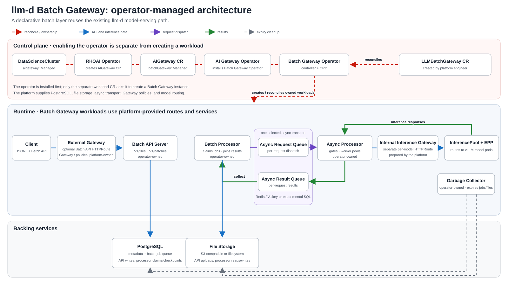
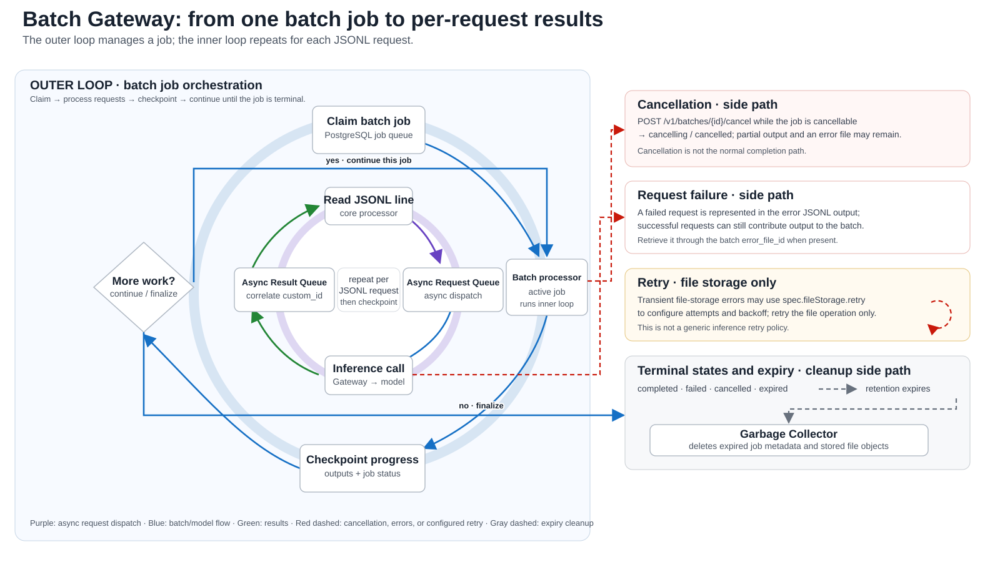

# Inside the Batch Gateway Operator: Deploying batch inference on Red Hat OpenShift AI 3.6

*A hands-on exploration of operator-managed batch inference, Kubernetes resources, and asynchronous request processing.*

## Why batch inference?

Imagine scoring a document corpus overnight or evaluating a new model. A run can take hours; the application still needs progress, cancellation, transient-error handling, and results if the client disconnects.

Without a batch service, each application builds its own long-running job system around synchronous calls. Batch Gateway provides an OpenAI-compatible Files and Batches workflow: upload JSONL, submit a job, poll its status, and retrieve output or error files. It dispatches requests through the existing llm-d serving path. The pinned source implements the [batch routes](https://github.com/opendatahub-io/batch-gateway/blob/0947400279d3dbdf892497c8435c4242c0386bf8/internal/apiserver/batch/batch_handler.go#L65-L91) and [file routes](https://github.com/opendatahub-io/batch-gateway/blob/0947400279d3dbdf892497c8435c4242c0386bf8/internal/apiserver/file/file_handler.go#L68-L100).

This walkthrough enables the operator through an existing RHOAI DataScienceCluster, inspects its managed resources, and submits a small batch. The cluster details and command output below were captured from a Red Hat OpenShift AI 3.6 test cluster.

> **Version scope:** This walkthrough follows the 3.6 handoff and pinned source commits, and the inspection output comes from a cluster running `rhods-operator.3.6.0`. Confirm the image/chart bundle and support phase for your exact release before production use; Red Hat's published 3.5 guide labels batch inference Technology Preview.

## What Batch Gateway adds to llm-d

Interactive inference is optimized around latency; batch inference is optimized around job throughput and a completion window. Clients submit a file and batch ID, then inspect progress, cancel eligible work, and retrieve output or error files later.

The API server handles `/v1/files` and `/v1/batches`; the core processor coordinates jobs and results; the async processor drains a request queue and calls the inference gateway; the garbage collector removes expired jobs and files.



*Figure 1. The Batch Gateway Operator manages the batch workloads; the platform team supplies the backing services, Gateway policies, and model route.*

That queue is distinct from the PostgreSQL queue of batch *jobs*. PostgreSQL stores job metadata and also backs the core batch-job queue. The asynchronous per-request dispatch queue is a separate choice: Redis/Valkey, or PostgreSQL through the SQL transport.

## Inside the operator reconciliation chain

On OpenShift, enabling the Batch Gateway Operator and creating a workload are separate operations. The RHOAI operator follows the DataScienceCluster setting and creates an `AIGateway` CR; the AI Gateway Operator then deploys the Batch Gateway Operator. The workload CR comes afterward, as Figure 1 shows.

The AI Gateway Operator's [`AIGateway` API](https://github.com/opendatahub-io/ai-gateway-operator/blob/7cace2afd13f352a72b3c4555b001729092fa730/api/components/v1alpha1/aigateway_types.go#L32-L48) gives `batchGateway` its own `managementState`, defaulting to `Removed`. Its [controller](https://github.com/opendatahub-io/ai-gateway-operator/blob/7cace2afd13f352a72b3c4555b001729092fa730/internal/controller/aigateway/aigateway.go#L247-L265) includes the Batch Gateway Operator manifests only when the state is `Managed`. The Batch Gateway Operator then watches `LLMBatchGateway` resources. It does not create a workload just because its own Deployment is running.

For each `LLMBatchGateway`, the controller validates the spec, resolves the credential Secret, renders the pinned Batch Gateway and llm-d-async Helm charts in-process, assigns controller owner references, and server-side applies the resulting Kubernetes objects. It periodically reconciles again, removes stale objects it owns, and updates status ([reconcile implementation](https://github.com/opendatahub-io/llm-d-batch-gateway-operator/blob/93f1c2c021a7ebae6f44c9e1dd05d7c9a34a46e8/internal/controller/llmbatchgateway_controller.go#L176-L272)). This is not a user-operated Helm release: the CR is the desired state, and the controller applies the rendered objects.

The generated core components are an API server Deployment, a processor StatefulSet, a garbage-collector Deployment, and an async-processor Deployment. The [operator reconcile test](https://github.com/opendatahub-io/llm-d-batch-gateway-operator/blob/93f1c2c021a7ebae6f44c9e1dd05d7c9a34a46e8/internal/controller/llmbatchgateway_controller_test.go#L897-L1001) checks three Deployments, one StatefulSet, Services, ConfigMaps, and ServiceAccounts. If enabled, the batch chart can render a Gateway API HTTPRoute, a cert-manager Certificate, and monitoring resources. Deleting the `LLMBatchGateway` removes its owned resources through owner references.

| Owner | What it manages |
|---|---|
| RHOAI and AI Gateway Operators | Platform integration and Batch Gateway Operator installation |
| Batch Gateway Operator | API server, processor, async processor, garbage collector, and configured optional resources |
| Platform team | PostgreSQL, Redis/Valkey (unless the async queue uses PostgreSQL), S3/filesystem storage, model routing, and Gateway policies |

## My Kubernetes cluster

These are the values from the cluster used for this walkthrough. It is a CPU-only test cluster: the model is the llm-d inference simulator, so it demonstrates the control and data paths, not inference performance.

| Item | Value |
|---|---|
| Kubernetes distribution and version | OpenShift 4.22.18 (Kubernetes v1.35.8), hosted control plane on OpenShift Virtualization |
| Red Hat OpenShift AI | `rhods-operator.3.6.0` |
| GPU and model | No GPU; `LLMInferenceService` `llm/batch-simulator` (llm-d inference simulator) serving model ID `test/batch-gateway-model` |
| Namespaces | `redhat-ods-applications` (operators), `batch-api` (Batch Gateway), `llm` (model), `openshift-ingress` (gateways) |
| Relevant components | RHOAI operator, `ai-gateway-operator` and `llm-d-batch-gateway-operator` Deployments, `AIGateway` `default-aigateway`, PostgreSQL, Redis, MinIO (S3-compatible) |

You can collect the same facts with `oc version`, `oc get clusterversion`, `oc get csv -n redhat-ods-operator`, and `oc get llminferenceservice -A`.

## Step 1: Enable Batch Gateway

The 3.6 handoff covers xKS `Platform`, OpenShift charts, and an existing RHOAI DataScienceCluster. I use the DSC path; the chart artifact tags were not verified. On this cluster the DSC CRD serves `v2` and `v3`.

First check that the installed cluster serves the expected DSC API and inspect the current object. Patch the platform-owned DSC; do not replace the full resource with a blog sample.

```bash
oc get crd datascienceclusters.datasciencecluster.opendatahub.io \
  -o jsonpath='{.spec.versions[?(@.served==true)].name}{"\n"}'
oc get datasciencecluster default-dsc -o yaml
oc explain datasciencecluster.spec.components.aigateway.batchGateway
```

If your installed 3.6 DSC schema uses `v3`, enable AI Gateway and its Batch Gateway subcomponent:

```bash
oc patch datasciencecluster default-dsc --type=merge \
  -p '{"spec":{"components":{"aigateway":{"managementState":"Managed","batchGateway":{"managementState":"Managed"}}}}}'
```

Wait for the RHOAI operator and AI Gateway Operator to reconcile. This step enables the Batch Gateway Operator; it does not create a workload CR or provision PostgreSQL, Redis/Valkey, object storage, the model route, or the external batch API route.

```bash
oc get datasciencecluster default-dsc -o yaml
oc get aigateway -o yaml
oc get deploy -n redhat-ods-applications
oc get crd llmbatchgateways.batch.llm-d.ai
```

On the test cluster, the DSC reports `aigateway` and `batchGateway` as `Managed`, the `AIGateway` is ready, and both operators run in `redhat-ods-applications`:

```text
$ oc get aigateway
NAME                READY   REASON   VERSION
default-aigateway   True             1.26.10

$ oc get deploy -n redhat-ods-applications ai-gateway-operator llm-d-batch-gateway-operator
NAME                           READY   UP-TO-DATE   AVAILABLE   AGE
ai-gateway-operator            1/1     1            1           39h
llm-d-batch-gateway-operator   1/1     1            1           39h
```

For xKS or chart-based OpenShift, follow release-published instructions only; the handoff did not confirm those 3.6 artifacts. Do not separately install the Batch Gateway Operator when AI Gateway owns it.

This example is non-MaaS. For a MaaS installation, keep Batch Gateway `Managed` and configure the MaaS component, Gateway listener, route labels, TLS, and required pass-through headers according to the platform's MaaS procedure. MaaS changes the gateway/authentication path; it does not remove the separate `LLMBatchGateway` workload CR or the backing-service requirements.

## Step 2: Create the LLMBatchGateway workload

Before applying, provide PostgreSQL, Redis/Valkey, and S3-compatible storage (or a pre-provisioned filesystem PVC). Reference a same-namespace Secret with `postgresql-url`, `redis-url`, and `s3-secret-access-key`; the S3 access key ID and endpoint are non-secret CR fields.

The following manifest uses the Redis sorted-set async transport documented by Red Hat and supported by the pinned source. The CRD requires `secretRef`, `fileStorage`, `apiServer`, `processor`, `gc`, and async configuration ([schema and API types](https://github.com/opendatahub-io/llm-d-batch-gateway-operator/blob/93f1c2c021a7ebae6f44c9e1dd05d7c9a34a46e8/config/crd/bases/batch.llm-d.ai_llmbatchgateways.yaml#L1318-L1430)). Replace the model ID, pool, URL, namespace, and storage placeholders. The model ID in each JSONL request must match the map key under `modelGateways`.

This operator API is async-only: set `processor.asyncConfig` and choose exactly one of Redis or SQL. Do not copy an older synchronous-dispatch manifest without checking the installed CRD. The generated schema defaults `dbBackend` to PostgreSQL, API server/core processor/GC replicas to one, and the GC interval to 30 minutes; the sample spells these out for clarity. It also defaults async concurrency to eight and Redis poll/batch values to 1000 ms/10, but `resultPollTimeout` has no schema default and is required by controller validation.

```yaml
apiVersion: batch.llm-d.ai/v1alpha1
kind: LLMBatchGateway
metadata:
  name: batch-gateway
  namespace: batch-inference
spec:
  secretRef:
    name: batch-gateway-secrets
  dbBackend: postgresql
  fileStorage:
    s3:
      bucket: <batch-bucket>
      region: <s3-region>
      endpoint: https://<s3-endpoint>
      accessKeyId: <s3-access-key-id>
      usePathStyle: true
  apiServer:
    replicas: 1
    config:
      batchAPI:
        passThroughHeaders:
          - Authorization
  processor:
    replicas: 1
    modelGateways:
      llama-3-8b:
        inferencePoolName: <inference-pool-name>
        inferenceObjective: batch-sheddable
    asyncConfig:
      concurrency: 4
      drainTimeout: 2m
      resultPollTimeout: 30s
      inferenceGateway:
        url: http://<internal-gateway-service>.<gateway-namespace>.svc.cluster.local/<model-namespace>/<model-name>
      prometheusURL: http://<prometheus-service>.<monitoring-namespace>.svc.cluster.local:9090
      redis:
        requestPathURL: /v1/chat/completions
        pollIntervalMs: 1000
        batchSize: 10
        queuesConfig:
          - name: llm-d-async:requests:<inference-pool-name>
            workerPoolID: default
            requestPathURL: /v1/chat/completions
            gateType: prometheus-budget
            gateParams:
              pool: <inference-pool-name>
              max_concurrency: "100"
              baseline: "0.05"
              fallback: "1.0"
      workerPools:
        - name: default
          workers: 4
  gc:
    replicas: 1
    interval: 30m
  httpRoute:
    enabled: true
    parentRefs:
      - name: <external-gateway-name>
        namespace: <gateway-namespace>
```

Use exactly one file backend (`s3` or `fs`). The optional `spec.fileStorage.retry` configures retries for transient file-storage errors only; it is not a generic inference retry policy ([API type](https://github.com/opendatahub-io/llm-d-batch-gateway-operator/blob/93f1c2c021a7ebae6f44c9e1dd05d7c9a34a46e8/api/v1alpha1/llmbatchgateway_types.go#L119-L195)). The controller also requires a nonempty `resultPollTimeout` and at least one `modelGateways` entry. An enabled HTTPRoute needs `parentRefs`, and its Gateway listener must allow the Batch Gateway namespace.

The example passes `Authorization` to a protected model route; it does not authenticate the external Batch API. Configure that Gateway policy separately. The handler stores configured pass-through values with PostgreSQL batch metadata, as discussed below.

`modelGateways` does not create the model route. The model's `InferencePool`, internal ClusterIP Gateway, per-model `HTTPRoute`, and `InferenceObjective` are separate resources. The example route uses the 3.6 handoff's `inference.networking.k8s.io` backend group; check served APIs before applying it. See [`internal-model-route.yaml`](batch-gateway-examples/internal-model-route.yaml).

```yaml
apiVersion: gateway.networking.k8s.io/v1
kind: HTTPRoute
metadata:
  name: batch-llm-route
  namespace: <model-namespace>
spec:
  parentRefs:
    - name: batch-internal-gateway
      namespace: <gateway-namespace>
  rules:
    - matches:
        - path:
            type: PathPrefix
            value: /<model-namespace>/<model-name>/v1/chat/completions
      filters:
        - type: URLRewrite
          urlRewrite:
            path:
              type: ReplacePrefixMatch
              replacePrefixMatch: /v1/chat/completions
      backendRefs:
        - group: inference.networking.k8s.io
          kind: InferencePool
          name: <inference-pool-name>
```

Create the matching `InferenceObjective` (for example, `batch-sheddable` at priority `-1`) in the model namespace. The internal Gateway listener must allow the model route; the external listener must allow the Batch API route.

For API-server TLS, add `spec.tls.enabled: true` and configure either an existing TLS Secret or `spec.tls.certManager` with an issuer. The operator then renders a Certificate when cert-manager support is enabled. That Certificate covers the API server backend; it does not configure the external Gateway's listener or backend trust policy for you.

## Step 3: Inspect the resources

The controller applies the rendered objects and sets the `LLMBatchGateway` as their controller owner. Use labels and owner references rather than relying on generated names:

```bash
NS=batch-inference
oc get llmbatchgateway -n "$NS" -o yaml
oc get deploy,statefulset,svc,cm,sa,role,rolebinding -n "$NS" \
  -l app.kubernetes.io/instance=batch-gateway
oc get httproute -n "$NS" -l app.kubernetes.io/instance=batch-gateway
oc get certificate -n "$NS" -l app.kubernetes.io/instance=batch-gateway
oc get events -n "$NS" --sort-by=.lastTimestamp
```

On the test cluster the gateway lives in `batch-api` and reports every component ready:

```text
$ oc get llmbatchgateway -n batch-api
NAME            READY   API-READY   PROC-READY   GC-READY   ASYNC-READY   AGE
batch-gateway   True    1           1            1          1             39h

$ oc get llmbatchgateway batch-gateway -n batch-api \
    -o jsonpath='{range .status.conditions[*]}{.type}={.status} {.reason}{"\n"}{end}'
APIServerAvailable=True Available
ProcessorAvailable=True Available
GCAvailable=True Available
AsyncProcessorAvailable=True Available
Ready=True AllComponentsReady

$ oc get deploy,statefulset -n batch-api -l app.kubernetes.io/instance=batch-gateway
NAME                                            READY   UP-TO-DATE   AVAILABLE   AGE
deployment.apps/batch-gateway-apiserver         1/1     1            1           39h
deployment.apps/batch-gateway-async-processor   1/1     1            1           39h
deployment.apps/batch-gateway-gc                1/1     1            1           39h

NAME                                       READY   AGE
statefulset.apps/batch-gateway-processor   1/1     39h
```

Each of those workloads has an owner reference to `LLMBatchGateway/batch-gateway`. The full inventory on this cluster matches the operator's reconcile tests, with one difference worth knowing:

| Kind | Observed on the 3.6 test cluster |
|---|---|
| Deployment ×3 | `batch-gateway-apiserver`, `batch-gateway-gc`, `batch-gateway-async-processor` |
| StatefulSet ×1 | `batch-gateway-processor` |
| Services ×2 | `batch-gateway-apiserver` (ports 8000 and 8081) and headless `batch-gateway-processor` |
| ConfigMaps ×3 | API server, processor, and GC configuration; the async processor receives its transport and queue configuration as container arguments instead |
| ServiceAccounts ×4 | API server, processor, GC, async processor |
| Certificate | `batch-gateway-apiserver-tls`, owned by the `LLMBatchGateway` because `spec.tls.certManager` is set |

On this cluster the external `batch-route` HTTPRoute was created by the platform installation, not by `spec.httpRoute`, so it has no owner reference. The Route and Certificate queries above return operator-owned resources only when those CR fields are enabled and the corresponding CRDs are installed. Monitoring CRs are similarly optional. To inspect the API contract actually installed by the platform, use `oc explain llmbatchgateway.spec --recursive` rather than assuming a newer upstream field is present; the 3.6 CRD on this cluster includes `httpRoute` (`enabled`, `parentRefs`, `annotations`) and `tls` (`enabled`, `secretName`, `certManager`).

The operator's status is based on actual Deployments and the processor StatefulSet. It reports component replica counts and a `Ready` condition; the controller requires the API server, processor, garbage collector, and async processor to be available. A successfully created custom resource is not the same as a ready workload.

## Step 4: Follow one batch through the system

1. `POST /v1/files` stores JSONL bytes in S3 or filesystem storage and file metadata in PostgreSQL. The upload uses `purpose=batch`.
2. `POST /v1/batches` validates the input file and endpoint, creates a `validating` job, and persists it. In the pinned product source, PostgreSQL's `batch_items` table is the job queue; processors claim rows with `FOR UPDATE SKIP LOCKED`.
3. The core processor validates each JSONL line, maps `body.model` through `modelGateways`, and builds an execution plan. Each `url` must be a supported relative path matching the batch endpoint; the method must be `POST`, and streaming is rejected.
4. The processor enqueues requests to the selected async transport. The async processor drains Redis sorted-set queues, applies dispatch gates and worker pools, and calls the internal inference gateway. A request's own endpoint overrides the queue's default path.
5. The core processor correlates results with `custom_id`, checkpoints them, and writes output/error JSONL to the configured file store.
6. `GET /v1/batches/{id}` reports state and output/error file IDs. The garbage collector removes expired metadata and file objects.



*Figure 2. The inner request loop runs for each JSONL line. Cancellation, per-request errors, configured storage retries, and retention expiry are side paths—not one generic retry or failure path.*

**Redis and SQL are alternative async request/result transports, not alternatives to the PostgreSQL batch database.** With Redis or Valkey, the async queue is a sorted set kept in deadline order. With the SQL transport (`asyncConfig.sql`), the async processor keeps the same semantics in PostgreSQL: earliest-deadline-first dispatch, leased claims that are redelivered if a dispatcher stops, per-queue gates, and backlog metrics. It reuses the `postgresql-url` from the same Secret and creates its own async queue tables next to the batch tables, so the deployment needs no Redis. Budget PostgreSQL connections for both the Batch Gateway processor and the async processor.

## Step 5: Submit and retrieve a real batch

Use the input in [`batch-gateway-examples/input.jsonl`](batch-gateway-examples/input.jsonl). Each line uses `custom_id`, `method`, `url`, and `body`. Its model value must be the same key used in `modelGateways`; `url` must equal the endpoint declared when creating the batch.

```bash
export BATCH_URL="https://<batch-api-host>"
export TOKEN="<short-lived-cluster-token>"
curl -fsS -X POST "$BATCH_URL/v1/files" \
  -H "Authorization: Bearer $TOKEN" \
  -F "purpose=batch" \
  -F "file=@batch-gateway-examples/input.jsonl"
```

Copy the returned file `id` into the batch request:

```bash
curl -fsS -X POST "$BATCH_URL/v1/batches" \
  -H "Authorization: Bearer $TOKEN" \
  -H "Content-Type: application/json" \
  -d '{"input_file_id":"<file-id>","endpoint":"/v1/chat/completions","completion_window":"24h"}'
```

Poll until the batch reaches a terminal state, then use `output_file_id` (and `error_file_id`, if present) with `GET /v1/files/{id}/content`:

```bash
curl -fsS "$BATCH_URL/v1/batches/<batch-id>" \
  -H "Authorization: Bearer $TOKEN" | jq .
curl -fsS "$BATCH_URL/v1/files/<output-file-id>/content" \
  -H "Authorization: Bearer $TOKEN" -o output.jsonl
jq -c . output.jsonl
```

To request cancellation while a job is still cancellable, use `POST /v1/batches/{batch_id}/cancel`. Cancellation and expiry can produce partial output and an error file. The provided `submit-batch.sh` automates upload, submission, polling, and retrieval without echoing the token.

## Step 6: Validate reconciliation—including negative input

I use two different checks because the API server and controller validate different things. The CRD rejects structural errors at admission. For example, setting both `processor.asyncConfig.redis` and `processor.asyncConfig.sql` violates a CEL rule. Run this server-side dry run in a cluster with the matching CRD:

```bash
bash batch-gateway-examples/validate.sh
```

Against the 3.6 CRD on the test cluster, the script reports the expected rejection:

```text
$ bash batch-gateway-examples/validate.sh
PASS: API-server admission rejected the invalid transport combination (expected negative test).
To test controller semantic validation in a disposable namespace, apply invalid-no-model-gateway.yaml
and verify Ready=False with reason ValidationFailed, then delete that LLMBatchGateway.
```

That script expects the API server to reject the manifest; rejection is a **passing negative-input test**, not an operator failure. A different mistake—such as omitting `modelGateways`—passes the CRD schema but fails controller semantic validation. In a disposable namespace, apply `invalid-no-model-gateway.yaml`, then inspect the status and events:

```bash
oc apply -f batch-gateway-examples/invalid-no-model-gateway.yaml
oc get llmbatchgateway invalid-no-model-gateway -n batch-inference -o yaml
oc describe llmbatchgateway invalid-no-model-gateway -n batch-inference
```

The controller records `Ready=False` with reason `ValidationFailed`, updates `observedGeneration`, and emits a warning event rather than creating the workloads. Delete the test object after inspecting it. Never apply the negative example in the namespace of a real gateway.

## Step 7: Troubleshoot by following ownership

| Symptom | First checks |
|---|---|
| Operator or CRD absent | Inspect DSC/AIGateway management state, operator Deployment, CSV/Subscription, and `llmbatchgateways.batch.llm-d.ai`. Do not create a second operator if AI Gateway owns it. |
| CR not ready | `oc describe llmbatchgateway ...`; inspect component replica counts, operator events/logs, and owned Deployments/StatefulSet. |
| Secret or PostgreSQL error | Confirm the same-namespace Secret exists and has the exact `postgresql-url` key; check DNS, TLS mode, credentials, and network reachability without printing secret values. |
| Files upload but processing stalls | Check file-store endpoint/permissions, processor logs, `redis-url`, queue names, async processor readiness, and that the queue URL reaches the intended internal gateway. |
| Requests fail at the model | Confirm the JSONL model ID matches a `modelGateways` key, the `InferencePool` is correct, its HTTPRoute is accepted, and the inference objective is configured in the EPP path. |
| HTTPRoute is not attached | Inspect the parent Gateway listener's route-namespace policy, route parent reference, namespace labels, and route status conditions. |
| API TLS fails | Check the Certificate and generated Secret when cert-manager is enabled; separately verify external Gateway listener TLS and backend trust configuration. |

Useful inspection commands include `oc describe httproute`, `oc get gateway -A`, and `oc logs -n "$NS" -l app.kubernetes.io/instance=batch-gateway --all-containers=true`. Adjust labels and namespaces to the installed release; the commands above intentionally do not show fabricated output.

## Production considerations

PostgreSQL, file storage, and the selected async transport are operational dependencies, not operator-provisioned services. Back up PostgreSQL/object storage, define retention, and budget PostgreSQL connections across components. SQL `maxConnections` applies per Batch Gateway processor replica, separate from the async processor pool. The pinned async chart renders one replica; the CRD replica field is reserved and does not enable HA scaling here.

Choose concurrency and dispatch gates with the model-serving team. `workerPools.workers` and async concurrency bound how much work the dispatcher can send, while inference objectives and the EPP flow-control configuration determine how batch requests coexist with interactive traffic. A label or objective in the Batch Gateway CR alone does not configure the inference gateway's policy.

Treat authentication, authorization, and rate limiting as separate boundaries. The operator can create the Batch API route, but Gateway API policies remain deployment-specific. The sample passes the original `Authorization` header to the inference route so model-level authorization can run. In the pinned API server code, configured pass-through header values are stored with batch metadata in PostgreSQL; the token is captured at submission and is not refreshed during processing. A short-lived token can expire while a queued job is still running. Before forwarding bearer tokens, review database access, retention, backups, token lifetime, and the approved credential strategy; only enable headers the route requires.

The operator can render a Certificate for API-server TLS and an HTTPRoute for `/v1/batches` and `/v1/files`. It does not configure your external Gateway, listener, DNS, policy engine, or a backend TLS policy. Monitoring objects are optional and depend on the corresponding Prometheus Operator CRDs.

## Conclusion

The operator makes the Batch Gateway workloads declarative, but the custom resource is only one layer of the deployment. The platform operator enables the sub-operator; the `LLMBatchGateway` CR manages its API server, core processor, async processor, and garbage collector; and platform engineers still provide databases, file storage, model routing, and Gateway API policies. Tracing those boundaries in the source is the safest way to distinguish what the 3.6 operator owns from what the cluster must already provide.

### References

- [Red Hat AI Inference 3.6 Batch Gateway installation handoff](https://github.com/aneeshkp/rhaii-docs/blob/d38076730c2331d85375b4fef26348d4e17fd12e/docs/batch-inference-installation-handoff.md)
- [RHOAI-side AI Gateway Operator reconciliation](https://github.com/opendatahub-io/ai-gateway-operator/tree/7cace2afd13f352a72b3c4555b001729092fa730)
- [Batch Gateway Operator API and controller (3.6 source)](https://github.com/opendatahub-io/llm-d-batch-gateway-operator/tree/93f1c2c021a7ebae6f44c9e1dd05d7c9a34a46e8)
- [ODH Batch Gateway chart/source pinned by the operator](https://github.com/opendatahub-io/batch-gateway/tree/0947400279d3dbdf892497c8435c4242c0386bf8)
- [ODH llm-d-async chart/source pinned by the operator](https://github.com/opendatahub-io/llm-d-async/tree/140885437eeb7fe0d0d59e6cc7bf1f548e9aaa09)
- [Upstream llm-d Batch Gateway v1.0.0](https://github.com/llm-d/llm-d-batch-gateway/tree/78a1dcd2870d1fe97fa3237a7ff091d38962a67e)
- [Red Hat AI Inference 3.5 batch inference documentation](https://docs.redhat.com/en/documentation/red_hat_ai_inference/3.5/html/batch_process_inference_requests_with_distributed_inference_with_llm-d/batch-inference-with-llmd_batch-processing-inference-requests)
- [Red Hat Developer: Batch inference architecture and workflows](https://developers.redhat.com/articles/2026/07/02/batch-inference-openshift-ai-llm-d)
- [OpenAI Batch API guide](https://platform.openai.com/docs/guides/batch)
